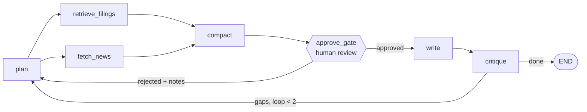
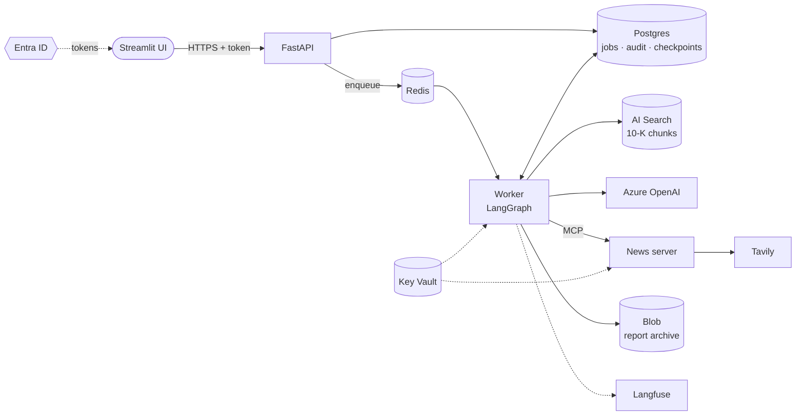
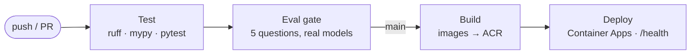

# Azure Market Intelligence Agent

[](https://dev.azure.com/meetbrij/market-intel-agent/_build/latest?definitionId=1&branchName=main)

Ask a research question about public companies and get back a structured
report in which every claim cites a specific page of an SEC 10-K filing or a
news URL. A LangGraph agent does the research, a human approves its plan
before it writes, and the whole thing runs keyless on Azure.

**Live demo:** [UI](https://ca-mia-ui.yellowrock-5f661b79.swedencentral.azurecontainerapps.io) ·
[API health](https://ca-mia-api.yellowrock-5f661b79.swedencentral.azurecontainerapps.io/health).
It runs on Azure Container Apps and may be scaled down between uses. Sign-in
is through Entra ID, with the `analyst` and `approver` roles.

## Intro

Analysts asking "how did AWS grow compared with Microsoft's cloud?" need an
answer they can check, not a fluent paragraph. This project is built around
one rule: **the model writes, but Python decides what counts as evidence.**

- **The writer cites by reference id only.** Company, period, page and
  chunk are filled in from what was actually retrieved.
- **Ungrounded citations are dropped:** an id that wasn't retrieved, or a
  quote that doesn't appear in its source.
- **The model never computes numbers.**
- **When the filings don't contain the answer, the system says so.** It
  declined 100% of the unanswerable questions in the eval.

Around that core sit the production concerns:
- a human approval gate, with separation of duties;
- crash-safe resumption from Postgres checkpoints;
- web content treated as untrusted;
- an append-only audit trail;
- tracing and cost per job;
- an eval gate in CI.

The corpus is the FY2025/26 10-Ks of Amazon, Alphabet and Microsoft, plus
live news from Tavily.

## What it does

| # | Step | What happens |
|---|---|---|
| 1 | Submit | An analyst asks a question, optionally filtered to companies. The API queues a job and returns its id. |
| 2 | Plan | The agent breaks the question into 3–5 sub-questions, picks companies and decides whether news is needed. |
| 3 | Research | It searches the 10-Ks (hybrid + semantic ranking, per company) **in parallel** with live news (an MCP server). News is sanitised and screened for injected instructions. |
| 4 | Compact | It condenses the evidence into a brief of about 2K tokens, keeping every reference id. |
| 5 | **Approve** | The job pauses. An approver (never the submitter) sees the plan and what was found, then approves it or rejects it with notes. A rejection re-plans. |
| 6 | Write | The agent writes a structured report. Every citation is checked against the retrieved evidence in Python. |
| 7 | Critique | An LLM review plus deterministic checks. If it finds gaps, it re-plans, at most twice per job. |
| 8 | Archive | `report.json`, `report.md`, provenance and every approval decision are written to Blob Storage, never overwritten. |

Every step is checkpointed in Postgres, so if the worker is killed mid-job,
the job resumes where it stopped.



The node-by-node failure behaviour is in [ARCHITECTURE.md](docs/ARCHITECTURE.md#agent-graph).

## Application

| Component | What it is |
|---|---|
| **API** (FastAPI) | Validates Entra ID tokens, enforces roles, stores jobs, enqueues work and serves reports |
| **Worker** (arq + LangGraph) | Runs the agent, checkpoints every step, recovers crashed jobs; exactly one replica |
| **News server** (MCP) | Wraps Tavily, sanitises results; the key stays in Key Vault |
| **UI** (Streamlit) | A thin client, HTTP only: submit, follow progress, approve or reject, read reports |
| **Ingestion** (CLI) | 10-K PDFs → page text → chunks → embeddings → Azure AI Search |

**API endpoints**

| Method | Path | Who |
|---|---|---|
| `POST` | `/api/v1/research` | analyst, approver: submit a question |
| `GET` | `/api/v1/research` | analyst (own jobs), approver (all) |
| `GET` | `/api/v1/research/{id}` | status, progress, plan awaiting review, report |
| `POST` | `/api/v1/research/{id}/resume` | approver, not the submitter: approve, or reject with notes |
| `GET` | `/api/v1/research/{id}/report.md` | the archived Markdown report |
| `GET` | `/api/v1/companies` | the companies in the index |
| `GET` | `/api/v1/ops/status` | approver: index size, last ingestion, jobs by status |
| `GET` | `/api/v1/me` | who you are and your roles |
| `GET` | `/health`, `/livez`, `/metrics` | readiness (Postgres + Redis), liveness, Prometheus |

**Roles**

| Role | Can |
|---|---|
| `analyst` | submit jobs; see and read their own jobs and reports |
| `approver` | everything an analyst can, plus see all jobs, approve or reject plans (not their own) and view operations status |

**Key behaviours**
- **Degrade, don't fail.** A Search or news outage is recorded in the
  report's `data_gaps`, and the run still completes. Only `plan`, `compact`,
  `write` and `critique` failures fail a job.
- **Bounded cost.** At most two plan passes per job. Rejections count toward
  the cap, and a decision applies only to the pass it was made for.
- **Auditable.** Every submission, decision, model call, withheld news item
  and job outcome goes to an append-only `audit_events` table.
- **Untrusted content stays data.** Web content is sanitised twice, screened
  by a classifier plus Azure Prompt Shields (failing closed), fenced in
  prompts and neutralised on rendering.

Walkthroughs and screenshots are in [DEMO.md](docs/DEMO.md).

| | |
|---|---|
|  |  |

## Tech stack

**Application**

| Tool | Used for |
|---|---|
| Python 3.12, uv | language and dependency management (separate groups for the UI and ingestion; RAGAS in its own environment) |
| LangGraph | the agent graph, human-in-the-loop interrupts, Postgres checkpointer |
| Azure OpenAI | `gpt-5-mini` for chat, `text-embedding-3-small` for embeddings |
| Azure AI Search | hybrid (BM25 + vector) retrieval with the semantic ranker |
| FastAPI, arq, Redis | the API and the job queue |
| PostgreSQL | jobs, audit events, LangGraph checkpoints |
| MCP (FastMCP), Tavily | the live news server |
| Streamlit, MSAL | the UI, signing in with the auth code flow and PKCE |
| Entra ID, PyJWT | tokens, app roles, keyless auth everywhere (`DefaultAzureCredential`) |
| Azure Prompt Shields | the second layer of the prompt-injection screen |
| Langfuse, Prometheus | tracing with cost per job; API and job metrics |
| RAGAS, pytest, ruff, mypy | evals, 188 offline tests, lint and types |

**Infrastructure and delivery**

| Tool | Type | Used for |
|---|---|---|
| Docker, Docker Compose | Both | hardened images; the full stack locally |
| Helm, kind | Infra | a production-shaped chart with NetworkPolicies, tested locally |
| Azure Container Apps | Infra | the live deployment: five apps, scale to zero |
| PostgreSQL Flexible Server | Infra | Entra-only auth; no password exists |
| Bicep | Infra | all Azure resources, deployed in two passes |
| Azure Container Registry | Both | images |
| Key Vault, Blob Storage | Infra | third-party keys; filings and the immutable report archive |
| Azure Pipelines | Pipeline | test → eval gate → build → deploy, with workload identity federation |

Deliberately not used: AKS (the same talking point as kind, at a monthly
cost; [ADR 0005](docs/adr/0005-kubernetes.md)), API keys for Azure services,
and LangChain agents (the graph is explicit).

## Architecture



The same images run in three places: Docker Compose on a laptop, a Helm
chart on kind, and Azure Container Apps.

In Azure:
- **Five container apps:**
  - api and ui are public;
  - news and Redis are internal only;
  - the worker has no ingress.
- **Identities:** each app runs with its own managed identity, holding only
  the roles that app needs.
- **Postgres** accepts only Entra tokens.

| Topic | Where |
|---|---|
| Components, graph, design rules, security layers | [ARCHITECTURE.md](docs/ARCHITECTURE.md) |
| Container Apps topology, identities, Helm, operations | [DEPLOYMENT.md](docs/DEPLOYMENT.md), [ADR 0006](docs/adr/0006-deployment-topology.md) |
| Tracing, metrics, measured costs | [observability.md](docs/observability.md) |

## CI/CD



Azure Pipelines (`infra/azure-pipelines.yml`) signs in to Azure through
workload identity federation, so there's no secret anywhere.

**The eval gate** runs five golden questions against the real models and
the real index on every push. It fails the build if any of these happen:
- faithfulness drops below 0.90;
- citation validity drops below 0.80;
- the unanswerable question gets answered;
- any score is missing.

Pull requests stop after the gate; `main` builds and deploys.

## Results

Measured, not estimated.

| | |
|---|---|
| **Retrieval lift** (hybrid + semantic vs vector) | context precision 0.54 → **0.81**; context recall 0.85 → **1.00**; wrongly declined questions 16% → **0%**; answer page retrieved 76% → **100%** ([benchmark](docs/retrieval-benchmark.md)) |
| **Faithfulness and abstention** | faithfulness **0.97** over 25 answerable questions; **100%** of unanswerable questions declined; citation validity **100%** ([EVALS.md](docs/EVALS.md)) |
| **Cost per report** | **$0.071** on average over 6 real reports ($0.033–$0.088; most took two passes), priced by Langfuse. It reconciles with the eval harness to $0.000001 |
| **Job latency** | machine time per report: median **7.4 min**, p95 **13.5 min** (low-quota gpt-5-mini, two passes typical) |
| **Resume after crash** | worker killed mid-report in Compose, on kind and in **Azure**: the job resumed from its last checkpoint without repeating completed steps |
| **Pipeline** | all four stages green; the apps run the pipeline-built images |
| **Tests** | 188 offline tests; ruff and mypy clean |

## Repository layout

```
app/
  api/            FastAPI: routes, auth (Entra ID), schemas, metrics
  graph/          LangGraph: state, nodes, prompts, retrieval, LLM calls, MCP client, checkpointer
  jobs/           jobs and audit tables, arq worker, crash recovery
  reports/        Markdown renderer, immutable Blob archive
  config.py, azure_clients.py, db_auth.py, observability.py, resilience.py
ingestion/        index schema, PDF parsing, chunking, ingest and verify CLIs
mcp_news/         MCP news server (FastMCP + Tavily) and sanitiser
ui/               Streamlit client (own image and dependency group)
evals/            golden set, harness, thresholds, cost reconciliation; ragas/ = isolated scorer
results/          committed eval runs (baseline and benchmark)
tests/            188 offline tests
infra/
  azure/          main.bicep, deploy.sh, power.sh, destroy.sh, db_setup.py
  azure-pipelines.yml
  entra/          app registrations and roles (setup.sh)
  helm/, kind/    Helm chart; local cluster scripts
scripts/          Azure smoke test, token helper
docs/             architecture, setup, deployment, evals, decisions, ADRs, media
```

## Quick start

```bash
uv sync
cp .env.example .env                           # Azure endpoints and deployment names
infra/entra/setup.sh <analyst-oid> <approver-oid>   # app registrations; paste the 3 ids into .env
uv run python -m ingestion.ingest --recreate   # index the 10-Ks
docker compose up -d --build                   # UI at http://localhost:8501, API at :8000
uv run pytest                                  # offline tests
```

Prerequisites, Azure roles and every setting are in [SETUP.md](docs/SETUP.md).
To deploy to Azure, run `infra/azure/deploy.sh`
([DEPLOYMENT.md](docs/DEPLOYMENT.md)).

## Known gaps and trade-offs

These are accepted on purpose for a portfolio-scale system. Each has a
known fix. The full list, with impact ratings, is in
[KNOWN_LIMITATIONS.md](docs/KNOWN_LIMITATIONS.md).

**Trade-offs made on purpose**

| Choice | Why | What it costs |
|---|---|---|
| Human approval before writing, on every pass | The reviewer sees the plan before the expensive step, and it can be audited | A job takes minutes and needs a second person; two passes often mean two approvals |
| At most two plan passes per job | Bounded cost and latency | The critic's remaining gaps go into the report rather than another pass |
| Exactly one worker | Crash recovery releases the stale queue lock safely only with one | No horizontal scaling of research jobs |
| Azure Container Apps, not AKS | Kubernetes is shown on kind; Container Apps scales to zero | No Kubernetes in the cloud deployment |
| Postgres over its public endpoint (Entra-only, TLS, firewall) | A VNet and private DNS cost more than the demo warrants | "Allow Azure services" admits any Azure-hosted client to the firewall (auth still required) |
| Free tiers: AI Search, semantic ranker plan | Cost | 50 MB index (62% used); 1,000 semantic queries a month, about 50–200 reports, then automatic fallback to hybrid |
| The LLM judge is the model under test | One chat deployment | RAGAS scores are comparisons between variants, not absolute figures |
| Annual 10-Ks only, three companies | Scope | No quarterly data; adding a company means editing an alias list |

**Gaps (not done)**

- **Number grounding is prompt-only.** Quotes are checked against their
  source, but figures in a section's prose aren't yet matched to the cited
  snippets.
- **Shortened reference ids.** The model occasionally abbreviates a long
  chunk id. Grounding drops those citations, and this occasionally failed
  the smoke gate (about 1 run in 3–4). The fix is short labels (`[E1]`,
  `[E2]`) mapped back to chunk ids in Python.
- **Two workers during a deploy.** Container Apps starts the new worker
  revision before stopping the old one, so a deploy during a running job can
  briefly run two. The workaround is to deploy between jobs.
- **Audit and archive immutability are enforced by the app**, not by the
  platform. The app's database role owns the audit table, and the Blob
  container has no WORM policy.
- **Re-ingestion isn't safe for the live index.** `--recreate` empties the
  live index first, and an upsert can leave stale chunks behind. There are
  no unit tests for `ingestion/`.
- **Raw exception text reaches clients** in `job.error`.
- **Tracing sends prompts and reports to Langfuse Cloud**, with no masking.
- **The demo clips aren't recorded yet.** There are screenshots in
  [docs/media/](docs/media/).

## Documentation

| Document | What it covers |
|---|---|
| [docs/ARCHITECTURE.md](docs/ARCHITECTURE.md) | Components, the agent graph and failure behaviour, design rules, security and untrusted-content layers, MCP news, the report archive |
| [docs/SETUP.md](docs/SETUP.md) | Prerequisites and Azure roles, Entra sign-in, ingestion, running locally, tests, the configuration reference |
| [docs/DEMO.md](docs/DEMO.md) | UI screens and screenshots; the API walkthrough (submit, reject, approve); the crash-resume demo |
| [docs/DEPLOYMENT.md](docs/DEPLOYMENT.md) | Images, Helm on kind, Azure Container Apps, deploy / pause / resume / destroy, CI/CD |
| [docs/EVALS.md](docs/EVALS.md) | The golden set, harness, metrics, CI gate thresholds and results |
| [docs/retrieval-benchmark.md](docs/retrieval-benchmark.md) | Vector vs hybrid vs hybrid + semantic ranker: setup, results and analysis |
| [docs/observability.md](docs/observability.md) | Langfuse tracing, `/metrics`, measured costs, cost reconciliation, the dashboard recipe |
| [docs/DECISIONS.md](docs/DECISIONS.md) | Every significant decision (D-01 to D-83), with alternatives and status |
| [docs/adr/](docs/adr/) | Architecture decision records 0001–0007: async jobs, graph topology, checkpointing, untrusted content, Kubernetes, deployment topology, report archive |
| [docs/KNOWN_LIMITATIONS.md](docs/KNOWN_LIMITATIONS.md) | Every accepted gap, with impact, the reason it's accepted and what would remove it |
| [docs/ROADMAP.md](docs/ROADMAP.md) | Deferred increments and their intended approach |
| [docs/archive/](docs/archive/) | The phase specs the project was built from (historical) |
| [CLAUDE.md](CLAUDE.md) | Rules for coding agents working in this repo |

## Project status

**Status (2026-10-09):** complete and frozen. All three phases are built,
deployed and verified. The live deployment stays up on Azure credits and
can be paused (`infra/azure/power.sh down`) or removed
(`infra/azure/destroy.sh`).

| Environment | URL | Deployed by |
|---|---|---|
| Local | `localhost:8501` (UI), `localhost:8000` (API) | `docker compose up` |
| Kubernetes (kind) | port-forward | `infra/kind/up.sh` |
| Azure | [UI](https://ca-mia-ui.yellowrock-5f661b79.swedencentral.azurecontainerapps.io) · [API](https://ca-mia-api.yellowrock-5f661b79.swedencentral.azurecontainerapps.io/health) | Azure Pipelines on `main` |

| Phase | Scope | Status |
|---|---|---|
| 1. Thin slice (Days 1–5) | Ingestion, a linear graph, API + worker, containers | **done** |
| 2. Agents and resilience (Days 6–12) | Full graph, MCP news, Postgres checkpoints, human approval, retries and fallback, Streamlit UI, report archive | **done**: crash resume verified |
| 3. Production (Days 13–18) | Golden set and evals; hybrid + semantic search; Entra ID auth, audit, injection screen; Langfuse and metrics; Helm on kind; Container Apps, Bicep, Azure Pipelines | **done**: context precision 0.81, 0 false declines, $0.071/report, pipeline green |
| Review fixes (Day 14.5) | Approval bound to its pass, rejection cap, quote grounding, fence hardening, honest eval gate | **done** |

**Optional next steps:**
- the [roadmap](docs/ROADMAP.md): a chunking strategy comparison, MLflow
  experiment tracking, an Airflow ingestion DAG, cross-job memory;
- short reference labels, to remove the intermittent smoke-gate failure;
- recording the demo clips.
