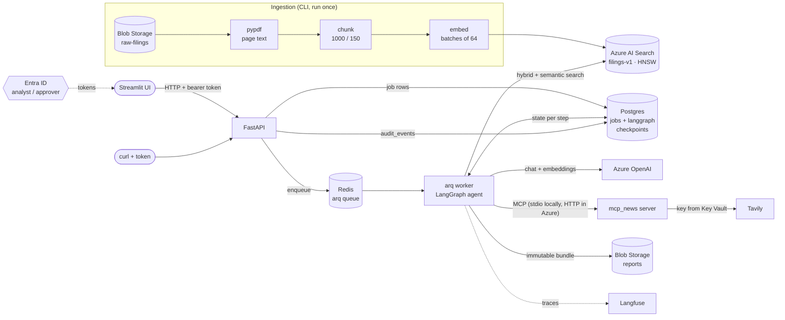
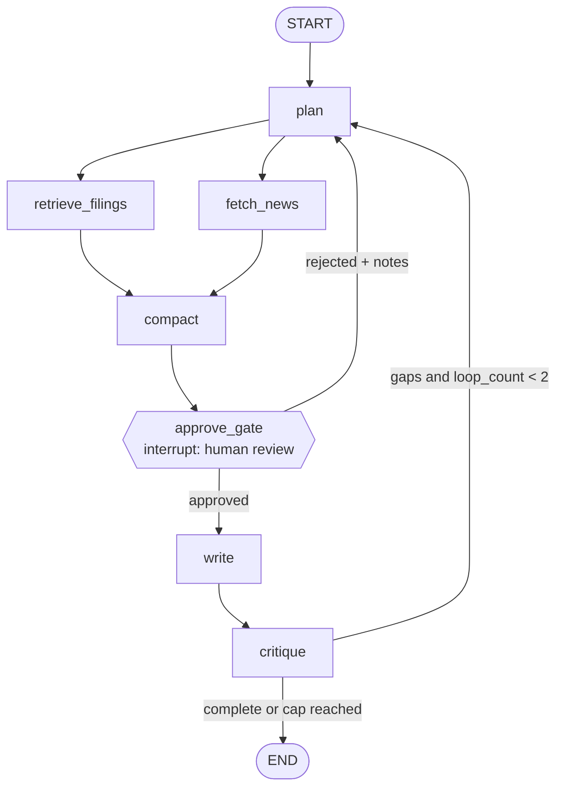

# Architecture

How the system is put together, and the design rules it follows. The
reasoning behind each choice is in [DECISIONS.md](DECISIONS.md) and the
[ADRs](adr/).

## Components

| Component | Code | Role |
|---|---|---|
| API | `app/api/` | validates tokens, enforces roles, stores jobs, enqueues work, serves reports; `/health`, `/livez`, `/metrics` |
| Worker | `app/jobs/` | an arq worker that runs the graph for each job; recovers jobs a dead worker left behind |
| Agent graph | `app/graph/` | the nodes, prompts, retrieval, LLM calls with fallback, the MCP client and the Postgres checkpointer |
| Report archive | `app/reports/` | renders the Markdown; writes the immutable bundle to Blob |
| News server | `mcp_news/` | an MCP server (FastMCP) that wraps Tavily and sanitises its results |
| UI | `ui/` | a Streamlit client; HTTP only, with its own image and dependency group |
| Ingestion | `ingestion/` | a one-off CLI: PDFs → page text → chunks → embeddings → the index |
| Evals | `evals/` | the golden set, the harness, the CI gate thresholds and the cost reconciliation |

## Agent graph

| Node | Does | If it fails |
|---|---|---|
| `plan` | 3–5 sub-questions, the companies, and whether news is needed (structured output) | the job fails (a Search outage falls back to the request's company filter) |
| `retrieve_filings` | hybrid + semantic-ranked search per sub-question (and per company), deduplicated | degrades: `data_gaps` |
| `fetch_news` | recent news through the MCP server, when the plan asks for it, screened for prompt injection | degrades: `data_gaps` |
| `compact` | condenses the evidence into a brief of about 2K tokens, keeping every reference id | the job fails |
| `approve_gate` | pauses with the plan and evidence counts until an approver resumes it | waits |
| `write` | the cited report, from the brief and the evidence | the job fails |
| `critique` | an LLM review plus deterministic citation checks; may send it back to `plan` | the job fails |

Why this shape, why the gate sits before the writer, and why the loop is
capped at two passes: [ADR 0002](adr/0002-graph-topology.md).

## Design rules

- **Citations are grounded in Python, not trusted from the model.**
  - The writer cites evidence by reference id only.
  - Company, period, page and chunk are filled in from the retrieved
    evidence.
  - A citation is dropped if its reference wasn't retrieved, or if its quote
    doesn't appear in its source.
  - The critic's deterministic checks override the LLM's verdict.
  - The model never computes numbers.
- **Human in the loop at the cheapest useful point.** The reviewer sees the
  plan and what was found before the expensive writing step, and can reject
  with notes to re-plan.
- **A hard cost cap.**
  - At most two plan passes per job (`MAX_LOOPS`).
  - Rejections count toward the cap, and rejecting the last pass ends the
    job.
  - A decision applies only to the pass it was made for (`expected_pass`).
- **Durable and resumable.**
  - Postgres checkpoints with `thread_id = job id`.
  - At startup, the worker recovers jobs a dead worker left `running`.
  - [ADR 0003](adr/0003-checkpointing.md).
- **Degrade, don't fail.**
  - A Search or news outage is recorded in the report's `data_gaps`, and the
    run still completes.
  - Transient errors (429, 5xx and timeouts) are retried with backoff.
  - Chat calls can fall back to a second deployment.
  - Each node has a wall-clock timeout.
- **A separate worker instead of FastAPI `BackgroundTasks`.** Jobs survive
  API restarts, and the API stays responsive
  ([ADR 0001](adr/0001-async-job-execution.md)).
- **Measured retrieval, not assumed.**
  - Hybrid search (BM25 + vector) with the semantic ranker is the default,
    because the eval showed it ([EVALS.md](EVALS.md)).
  - Each requested company gets its own top-k. Otherwise "Google Cloud"
    chunks crowd out Amazon's "AWS" chunks.
- **Keyless everywhere.**
  - Every Azure client uses `DefaultAzureCredential`, including Postgres in
    Azure.
  - The only third-party key (Tavily) lives in Key Vault.
  - Deployment names come from configuration, so swapping a retired model is
    a config change.
- **Additive-only report schema; archived reports are never overwritten.**

## Security

- **Authentication:**
  - every API call needs an Entra ID v2 access token, which the API
    validates itself (signature, issuer, audience, expiry);
  - the UI signs in with the auth code flow and PKCE, with no client secret.
- **Authorisation:** two app roles.
  - `analyst` submits jobs and sees their own.
  - `approver` sees every job and decides on them.
  - Nobody can approve a job they submitted.
  - The UI hides what the API would refuse, but the API is what enforces it.
- **Audit:** an append-only `audit_events` table (enforced by a Postgres
  trigger) records:
  - every submission and decision;
  - every model call;
  - every withheld news item;
  - every job outcome.
- **Dev bypass:** `DEV_AUTH_BYPASS` exists for offline work, and the API
  refuses to start with it outside `ENVIRONMENT=local`.

### Untrusted web content

Everything fetched from the web is treated as data, never as instructions
([ADR 0004](adr/0004-untrusted-content.md)):

1. **The news server sanitises the results:**
   - decodes entities, then strips HTML (including script and style blocks),
     repeating until the text stops changing;
   - caps titles at 200 and snippets at 500 characters;
   - drops non-http(s) URLs and skips social platforms.
2. **The graph's client sanitises again**, because a remote server can't be
   trusted to have done it.
3. **News is screened for injected instructions** before it reaches any
   prompt, by a classifier plus Azure Prompt Shields. The screen fails
   closed: if it can't run, the news is dropped and recorded.
4. **Prompts fence all web text** (titles included) in
   `<untrusted_web_content>` tags, with fence tokens and angle brackets
   defused. The prompts say never to follow instructions found inside.
5. **On rendering:**
   - quoted source text is escaped;
   - model-written prose has images, inline links and raw HTML neutralised.
6. **Least privilege for the news server:** the stdio news server receives
   only the environment variables it needs for Key Vault, and in Azure it is
   a separate app with its own identity.

## Live news (MCP)

`mcp_news/` is an [MCP](https://modelcontextprotocol.io) server (FastMCP)
that wraps Tavily. It has two tools:

- `search_company_news(company, days=7, max_results=5)`
- `get_market_context(topic)`

Both return `{title, url, published, snippet}`. The Tavily key is read from
Key Vault with keyless auth and never leaves the server process.

The worker opens one MCP session and keeps it for its lifetime, reconnecting
with backoff if the server goes away.
- **Locally**, it spawns the server over stdio.
- **In Kubernetes and Azure**, `NEWS_MCP_URL` points it at the separately
  deployed streamable-HTTP server.
- **If news is unavailable**, the run continues without it, and the report's
  `data_gaps` says so.

## Report archive

Each completed job writes these to `reports/{yyyy}/{mm}/{job_id}/` in Blob
Storage:
- `report.json` and `report.md`;
- `provenance.json`: evidence references, plus the models and tokens per
  node;
- `approval-pass{n}.json` for every decision, naming the reviewer from their
  token.

Uploads never overwrite an existing blob. `GET /api/v1/research/{id}/report.md`
serves the archived Markdown (`X-Report-Source: archive`). If archiving
failed, it renders from the job record instead
([ADR 0007](adr/0007-report-archival.md)).

## Observability

- **Tracing:** Langfuse, with one trace per job (trace id = job id). It
  shows each node, model call, search and tool call, with tokens and the
  cost per node.
- **Metrics:** `GET /metrics` (Prometheus) gives request latency per route
  and jobs by status.
- **Cost check:** an eval run's cost reconciles with the harness's own
  calculation to the sixth decimal.

Details, measured costs and the dashboard recipe are in
[observability.md](observability.md).
