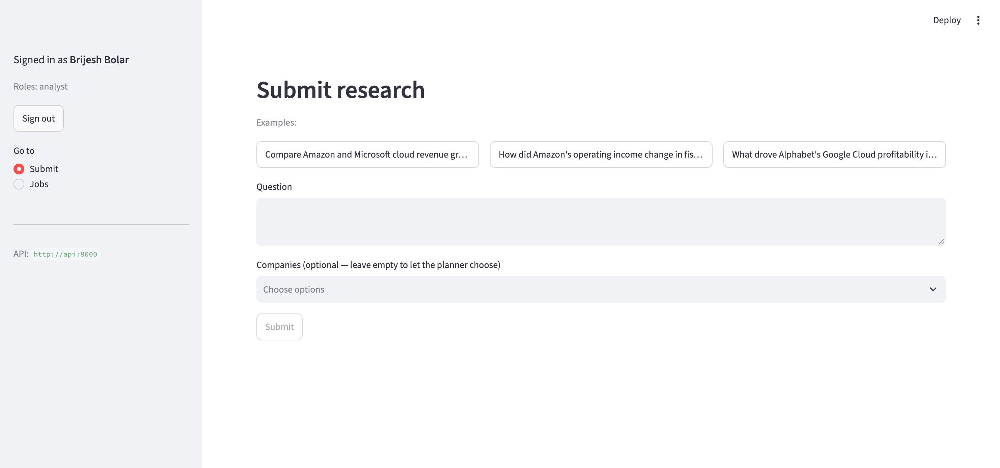
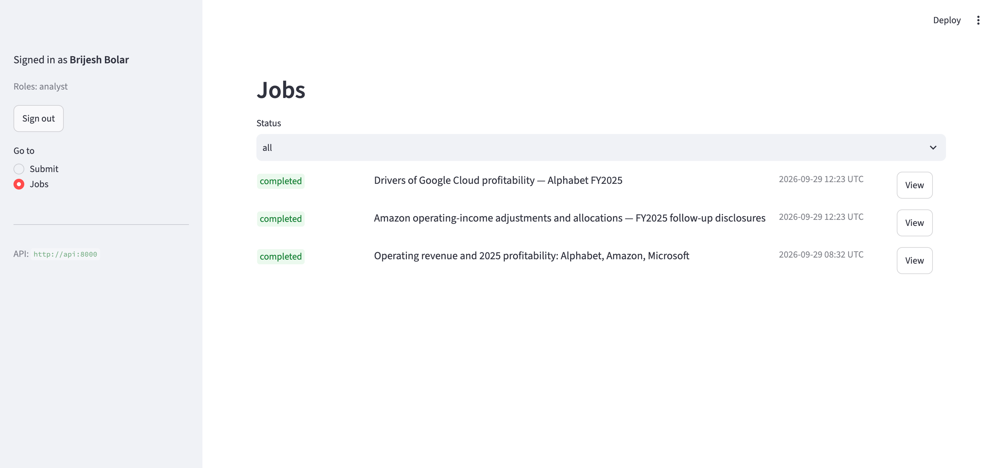
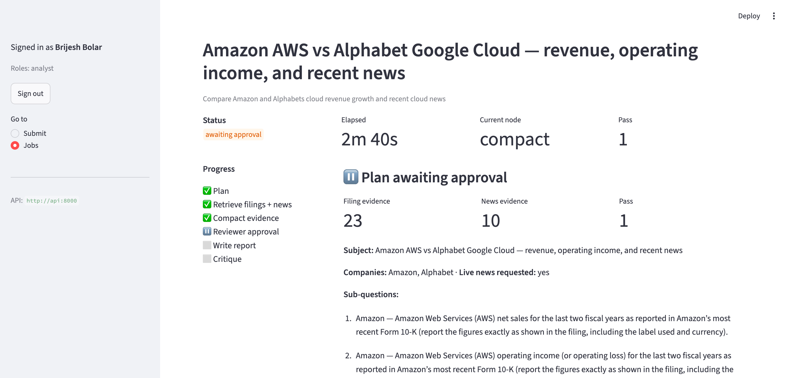
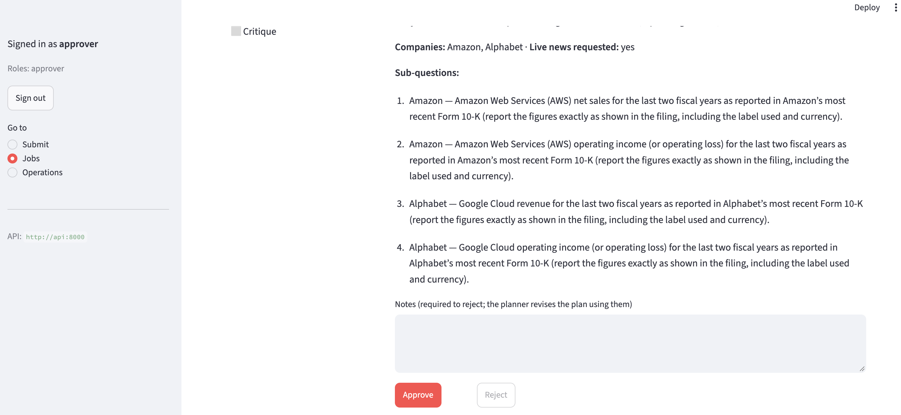
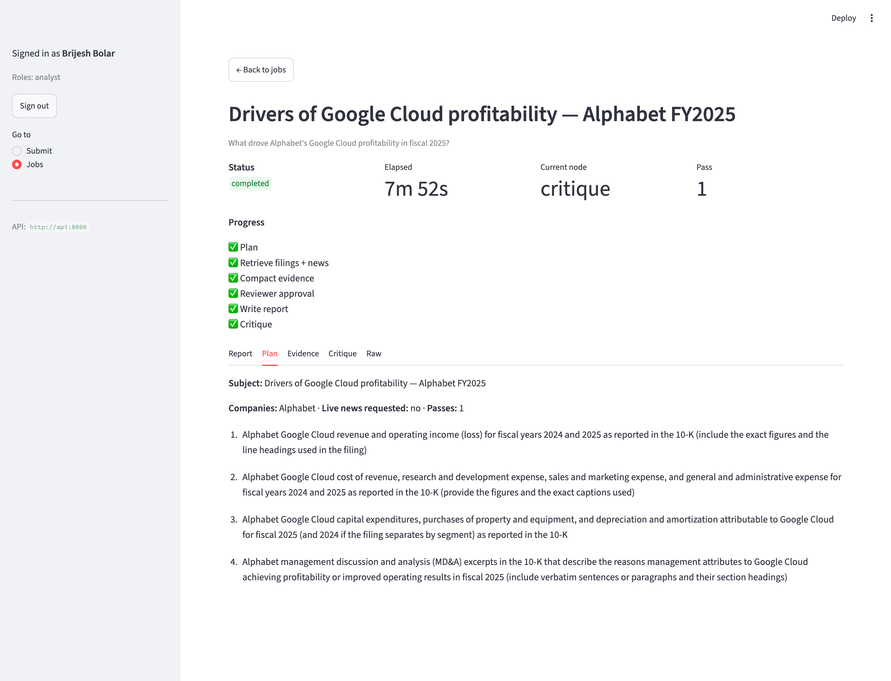
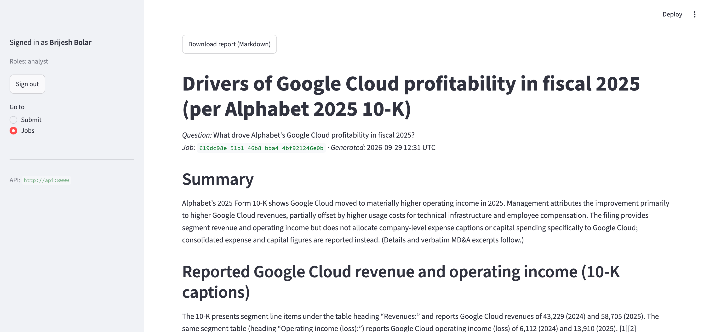

# Demo walkthroughs

Three ways to see the system work:
- through the web UI;
- through the API with curl, which shows the approval gate and the rejection
  loop;
- by killing the worker mid-run to show crash resume.

These assume the stack is running locally ([SETUP.md](SETUP.md)). Most of
them also work against the [live Azure deployment](DEPLOYMENT.md#azure-container-apps).

## 1. Web UI (Streamlit)

The UI is a thin client over the API, for demonstrating the approval gate
and crash resume, and for reading reports. It's a demo harness, not a
product. It talks to the system **only over HTTP** (`ui/api_client.py`) and
runs in its own image containing just Streamlit, httpx and MSAL, so it can't
import the graph or reach Postgres.

**Sign-in:** click *Sign in with Microsoft*. You sign in at Microsoft and are
sent back to the app. This is the auth code flow with PKCE (`ui/auth.py`), so
there's no client secret. The sidebar shows who you are and your app roles, as
the API sees them (`GET /api/v1/me`). Tokens live only in your browser
session and are refreshed silently. Reloading the page means signing in again.

| Screen | Who | What |
|---|---|---|
| Submit | analyst, approver | a question (with example presets), and an optional company filter drawn from the index |
| Jobs | analyst: their own jobs; approver: all | recent jobs with status badges. For approvers, jobs awaiting approval come first, flagged 🔔, with who submitted them |
| Job detail | analyst (own), approver | status, elapsed time, current node, pass counter and degraded-source warnings; live progress (polls every 2 s until the job settles) |
| ↳ tabs | same | **Report** (the archived Markdown, data gaps up front, numbered citations, download), **Plan**, **Evidence** (filings and news, with snippets as plain text), **Critique**, **Raw** JSON |
| ↳ approval | approver, but not the submitter | the plan, evidence counts and sub-questions; **Approve**, or **Reject** with required notes, which sends it back to the planner |
| Operations | approver | index size, last ingestion (from the ingest CLI's manifest), job counts by status and running jobs; read-only |

The UI only hides what the API would refuse anyway. The API enforces the
roles and the "not your own job" rule from the token. Approval records in
the archive name the reviewer from their token.

`Planner`, `Writer` and `Critic` are agent nodes in the graph, not human
roles. The job view shows what each one produced, as tabs.

| | |
|---|---|
|  |  |
|  |  |
|  |  |

A sample archived report: [media/sample_report-generated.md](media/sample_report-generated.md).

## 2. API: submit, reject, approve, get the report

This needs two people: an analyst submits, and a different approver
decides. Get a token for each. A browser window opens to sign in; sign in as
the approver the second time.

```bash
export ANALYST=$(uv run --group ui python scripts/get_token.py)
export APPROVER=$(uv run --group ui python scripts/get_token.py)
```

```bash
JOB=$(curl -s -X POST localhost:8000/api/v1/research -H "Authorization: Bearer $ANALYST" \
  -H 'content-type: application/json' \
  -d '{"query":"Compare Amazon and Microsoft cloud revenue growth and recent cloud news","companies":["Amazon","Microsoft"]}' \
  | python3 -c 'import json,sys; print(json.load(sys.stdin)["job_id"])')

# queued -> running (last_node / checkpoint_count show progress) -> awaiting_approval
until curl -s -H "Authorization: Bearer $ANALYST" localhost:8000/api/v1/research/$JOB | grep -Eq '"status":"(awaiting_approval|completed|failed)"'; do sleep 3; done
curl -s -H "Authorization: Bearer $ANALYST" localhost:8000/api/v1/research/$JOB | python3 -m json.tool   # "interrupt" holds the plan to review
```

The job waits at `awaiting_approval` until an approver (not the submitter)
decides:

```json
"interrupt": {
  "pass": 1,
  "companies": ["Amazon", "Microsoft"],
  "sub_questions": ["Amazon AWS net sales and year-over-year growth ...", "..."],
  "needs_live_news": true,
  "evidence_counts": {"filings": 18, "news": 10},
  "degraded": []
}
```

```bash
# Reject with notes: the planner revises the plan and the job pauses again
curl -s -X POST localhost:8000/api/v1/research/$JOB/resume -H "Authorization: Bearer $APPROVER" \
  -H 'content-type: application/json' \
  -d '{"approved": false, "notes": "Use the latest fiscal year vs the prior year only.", "expected_pass": 1}'

# Approve pass 2: write -> critique. (Without the rejection, a critic that finds
# gaps would re-plan once more; the rejection already used that pass.)
curl -s -X POST localhost:8000/api/v1/research/$JOB/resume -H "Authorization: Bearer $APPROVER" \
  -H 'content-type: application/json' -d '{"approved": true, "expected_pass": 2}'

until curl -s -H "Authorization: Bearer $ANALYST" localhost:8000/api/v1/research/$JOB | grep -Eq '"status":"(completed|failed)"'; do sleep 3; done
curl -s -H "Authorization: Bearer $ANALYST" localhost:8000/api/v1/research/$JOB | python3 -m json.tool
```

The result, trimmed, from a real run:

```json
{
  "status": "completed",
  "last_node": "critique",
  "checkpoint_count": 12,
  "report": {
    "summary": "Amazon reported AWS net sales of $128,725 (FY2025) and $107,556 (FY2024); Amazon stated “AWS sales increased 20% in 2025.” Microsoft reported Intelligent Cloud revenue of $137,791 (FY2026) and $106,265 (FY2025) ...",
    "sections": [
      {
        "heading": "Amazon AWS — revenue and operating income (FY2024–FY2025)",
        "citations": [
          {
            "source_type": "filing", "reference": "amzn-annual-report-10k-145",
            "company": "Amazon", "doc_type": "10-K", "period": "2025-12-31",
            "source_blob": "amzn_annual_report_10k.pdf", "chunk_no": 145, "page": 25,
            "quote": "AWS sales increased 20% in 2025, compared to the prior year."
          }
        ]
      },
      {
        "heading": "Recent cloud-related developments after the fiscal-year ends",
        "citations": [
          {
            "source_type": "news", "company": "Microsoft", "period": "2026-09-23",
            "reference": "https://www.bradenton.com/news/business/article317353820.html",
            "quote": "Microsoft plans $10 billion-plus Gulf investment with focus on resilience"
          }
        ]
      }
    ],
    "data_gaps": []
  }
}
```

**Job statuses:**
- `queued`, `running`, `awaiting_approval`, `completed`, `failed`.
- Resuming a job that isn't paused returns 409, as does a decision for the
  wrong `expected_pass`.
- An unknown id returns 404.
- The submitter trying to approve their own job gets 403.

## 3. Kill the worker mid-run and watch it resume

```bash
# Submit a job (as above). Once "last_node" is "plan" (retrieval in flight):
docker compose kill worker          # SIGKILL: no cleanup runs
docker compose up -d worker
docker compose logs -f worker
```

```
WARNING Recovering job 24dfc2b4-… (last node plan, 1 checkpoints): still queued; lock released
INFO    Job 24dfc2b4-… resuming from checkpoint; completed nodes are skipped, next=['retrieve_filings', 'fetch_news']
INFO    fetch_news: 10 new item(s)
INFO    retrieve_filings: 18 hit(s), 18 new, 18 total
INFO    Job 24dfc2b4-… awaiting approval (pass 1)
```

`plan` doesn't run again: the job resumes from its last checkpoint. On
startup, the worker releases the dead worker's queue lock (otherwise held
for 610 s) and re-enqueues every job still marked `running`.

The same test passed on kind and in Azure Container Apps. In Azure, a worker
restarted mid-write resumed with `next=['write']`
([ADR 0006](adr/0006-deployment-topology.md)).

## Demo clips (still to record)

Three short clips for `docs/media/`:

1. **Happy path:** submit → progress → approval → approved → cited report.
2. **Crash resume:** `docker compose kill worker` mid-run, then restart it.
   The UI keeps showing progress, and the job completes from its checkpoint.
3. **Rejection loop:** reject with notes. The planner runs again, and the
   report follows the notes.
