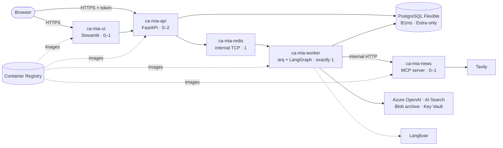
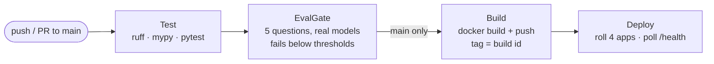

# Deployment and operations

The same images run in three places:

| Where | What it's for | How |
|---|---|---|
| Docker Compose | local development | [SETUP.md](SETUP.md) |
| Kubernetes on kind (Helm) | a production-shaped chart, tested locally | [below](#kubernetes-helm-on-kind) |
| Azure Container Apps | the live deployment, with CI/CD | [below](#azure-container-apps) |

Everything is keyless in all three: no API keys in code, and no database
password in Azure.

## Container images

- **Base images:** pinned by digest.
- **Runtime image:** pip removed; runs as non-root.
- **Health checks:** a `HEALTHCHECK` per component (`MIA_COMPONENT=api|worker|news`).
- **Targets:**
  - `runtime`: what gets deployed;
  - `local`: adds the Azure CLI for local auth;
  - the UI has its own image (`ui/Dockerfile`) and never imports `app`.
- **Size:** the runtime image stayed at 397 MB before and after hardening.
  Dropping precompiled bytecode would save 57 MB but doubles start time
  ([ADR 0005](adr/0005-kubernetes.md)).

## Kubernetes (Helm on kind)

`infra/helm/` deploys the api, worker, MCP news server and UI, plus Postgres
and Redis in the cluster for demos. One command sets up a local cluster:

```bash
infra/kind/up.sh            # kind cluster, images, ConfigMap from .env, helm install
kubectl port-forward svc/mia-ui 8501:8501    # sign in at http://localhost:8501
kubectl port-forward svc/mia-api 8000:8000   # the API, for curl
infra/kind/down.sh          # delete the cluster
```

- **Pods:** non-root, with a read-only root filesystem and no capabilities.
- **Probes:** liveness is kept apart from readiness. A database outage takes
  the API out of rotation; it doesn't restart it.
- **Worker:** exactly one, with the `Recreate` strategy.
- **NetworkPolicies:** only the worker may reach the news server, and only
  the api and worker may reach Postgres and Redis. Enforcement was checked on
  kind.
- **News server:** its own service over streamable HTTP. The worker
  reconnects with backoff if it restarts.

[ADR 0005](adr/0005-kubernetes.md) explains why there's no AKS: it costs
money every month for the same talking point.

## Azure (Container Apps)

**Live** (a demo; it may be scaled down between uses):
- UI: <https://ca-mia-ui.yellowrock-5f661b79.swedencentral.azurecontainerapps.io>.
  Sign in with an account that has the `analyst` or `approver` role.
- API: <https://ca-mia-api.yellowrock-5f661b79.swedencentral.azurecontainerapps.io/health>



- **Five container apps.**
  - api and ui are public over HTTPS.
  - news uses internal HTTP, and Redis internal TCP.
  - The worker has no ingress and runs exactly one replica.
  - api, ui and news scale to zero when idle.
- **PostgreSQL Flexible Server (B1ms) with Entra-only auth.** The apps log
  in with their managed identity's token (a fresh token per connection). No
  database password exists anywhere.
- **Identities:** one user-assigned managed identity per app, each with only
  the roles that app needs, plus a shared database identity.
- **Bicep** (`infra/azure/main.bicep`), deployed in two passes: the base
  resources, then the apps once their images exist.
- **Budget:** a $50 monthly budget, with alerts on actual and forecast
  spend.

The topology, the identity-to-role table and the trade-offs are in
[ADR 0006](adr/0006-deployment-topology.md).

### Deploy, pause, resume, destroy

```bash
infra/azure/deploy.sh --what-if     # preview; creates nothing
infra/azure/deploy.sh               # base → images → Postgres role → apps

infra/azure/power.sh status         # what's running; is the API healthy
infra/azure/power.sh down           # pause: stop Postgres; scale the worker and Redis to zero
infra/azure/power.sh up             # resume, and wait until the API is healthy

infra/azure/destroy.sh --dry-run    # list what would be deleted
infra/azure/destroy.sh              # delete the deployment (asks you to confirm)
```

- **`power.sh down`** keeps everything and saves most of the cost. Azure
  restarts a stopped Postgres server after 7 days, so run it again if the
  pause should last longer.
- **`destroy.sh`** removes only what `deploy.sh` created: the apps, the
  environment, Log Analytics, Postgres, the registry, the identities and
  their role assignments. It keeps the Day 1 resources (OpenAI, the Search
  index, the filings and report archive, and Key Vault), so `deploy.sh` can
  bring the whole thing back.

Images are built locally with `docker buildx --platform linux/amd64`, or on
the pipeline agent. ACR Tasks (`az acr build`) is blocked on this
subscription (DECISIONS D-81).

## CI/CD (Azure Pipelines)



`infra/azure-pipelines.yml`:
- **Auth:** an Azure Resource Manager service connection that uses
  workload identity federation, so there's no secret in the pipeline. Its
  identity has Contributor on the resource group, plus Cognitive Services
  OpenAI User and Search Index Data Reader for the eval gate.
- **Eval gate:** runs `evals.run --smoke` against the real models and the
  real index. It fails on a missing score, below the thresholds in
  `evals/thresholds.yaml`, or on an answered unanswerable question. Its
  results are published as a pipeline artifact.
- **Pull requests** run Test and EvalGate only. Build and Deploy run on
  `main`.
- **Deploy:** rolls news, worker, api and ui to the new image tag, then
  waits for `/health`.

Verified: run 25 passed all four stages, and the apps run `mia:25` and
`mia-ui:25`.
